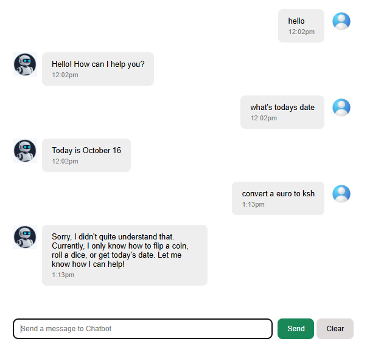

# React Chatbot

A simple interactive chatbot built with React and JavaScript. The application allows users to enter messages and receive responses to a set of predefined questions and commands.

## Features

- Interactive chat interface
- User input and chatbot responses
- Predefined responses to supported questions and commands
- Chat state management using React
- Asynchronous response handling
- Message timestamps

## Technologies Used

- React
- JavaScript
- HTML
- CSS
- Day.js

## Current Limitations

The chatbot currently responds to a limited set of predefined questions and commands. It does not yet retrieve live information from external APIs or generate open-ended AI responses.

## Future Improvements

- Integrate an external API to retrieve real-time information
- Expand the chatbot's response capabilities
- Improve error handling and loading indicators
- Enhance the user interface and accessibility

## Learning Goals

This project is part of my ongoing practice in React development, focusing on components, state management, event handling, and asynchronous JavaScript.

